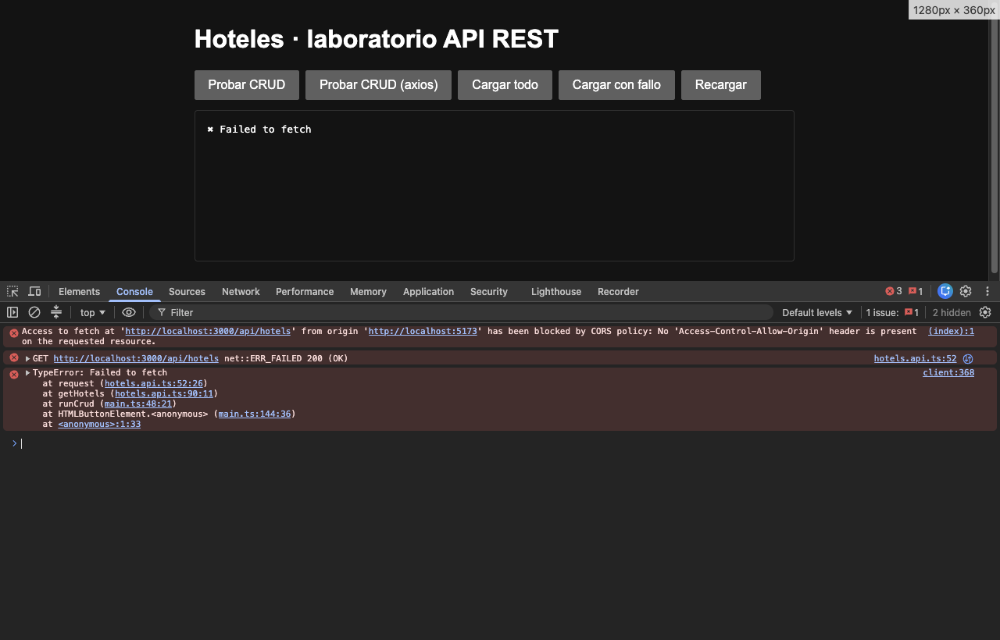
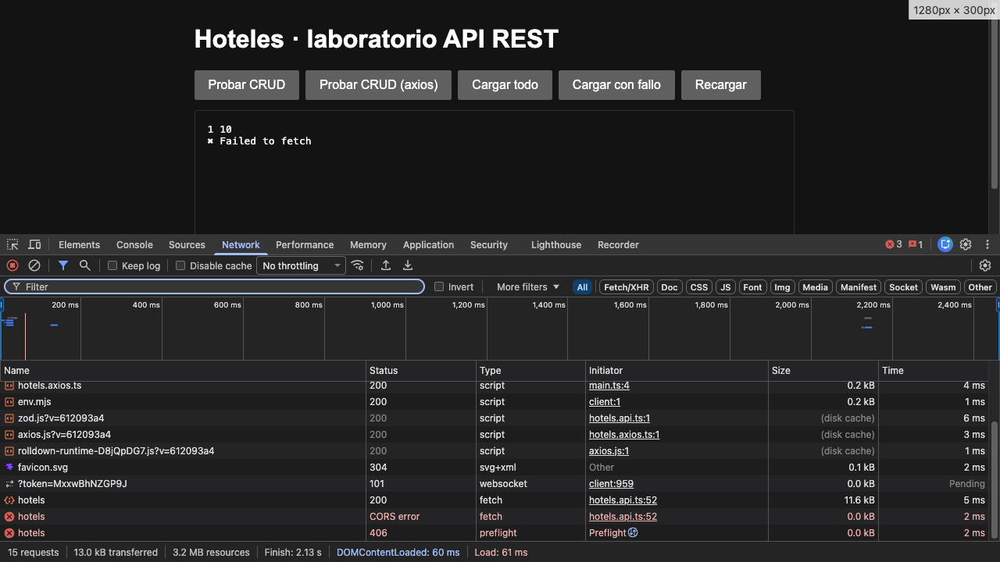
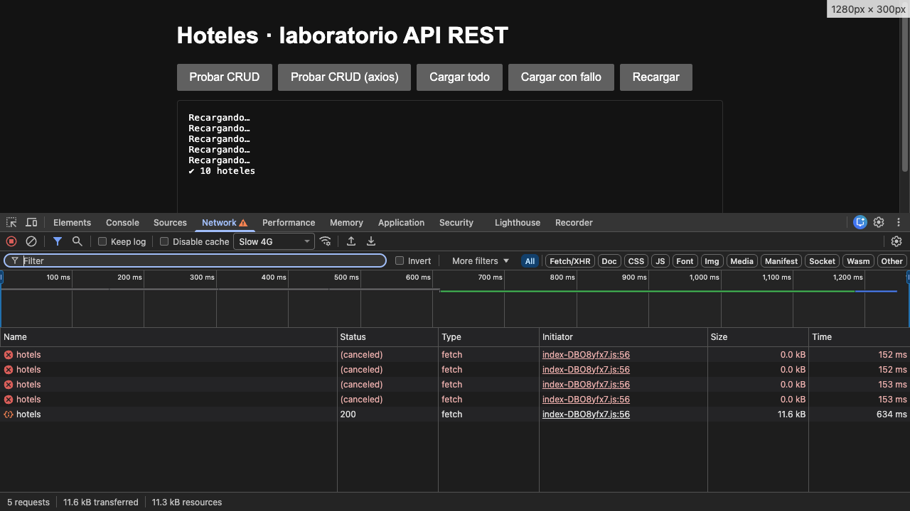
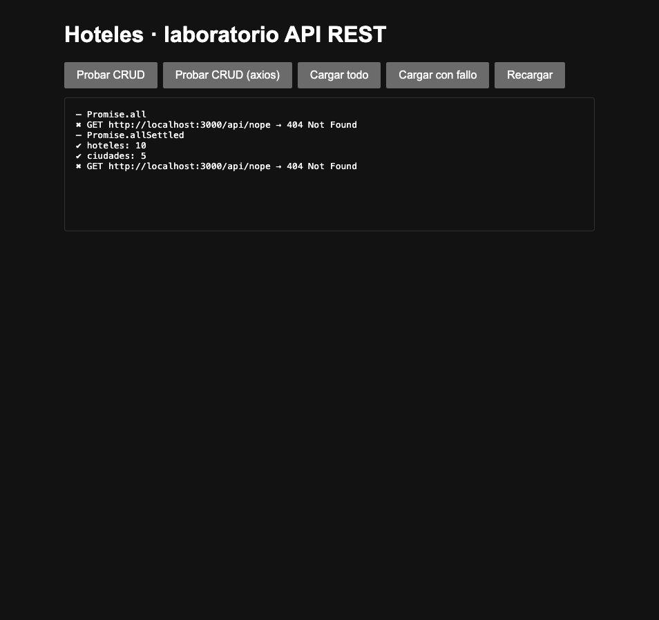

# 🏨 Hoteles · Laboratorio del módulo 5 (API REST)

Un cliente en TypeScript (sin framework) que habla con el `hotels-server` del módulo: CRUD completo con `fetch`, la misma API desde otro origen (CORS), peticiones en paralelo, con fallos y canceladas. Además: una versión con axios, el proxy de Vite, validación con Zod, la aplicación React `client-cors` contra la API real, Tueste (laboratorio 4) contra json-server, el servidor arreglado para que se porte como dice la teoría, tiempo máximo y reintentos, y el diseño de la API de Tueste. Parte de `05-api-rest/.start-code`. Cada obligatorio, opcional y desafío tiene su propio commit (`git log --oneline`).

Versiones: Node 22.17, Vite 8.3, TypeScript 6.0, axios 1.21, Zod 4.6 · servidor: Express 5.3, cors 2.8, tsx 4.23 · json-server 0.17.

> ⚠️ **El servidor está arreglado (D1).** La tabla de O1, las respuestas de O1 a O4 y las capturas describen el servidor **original** del módulo, el del commit `6018cbb`. Para reproducirlas tal cual: `git checkout 6018cbb -- hotels-server/src`. Lo que cambia con D1 está en [su apartado](#d1--arreglar-el-servidor).

## 🚀 Cómo arrancarlo

**1. El servidor** (en una terminal):

```bash
cd hotels-server
npm install
npm run dev                        # http://localhost:3000, sin CORS
USE_CORS=yes npm run dev           # con CORS (macOS / Linux)
$env:USE_CORS="yes"; npm run dev   # con CORS (Windows PowerShell)
```

> Los datos viven en memoria: cada reinicio (también al guardar un fichero del servidor, por `tsx watch`) vuelve a los 10 hoteles iniciales.

**2. El cliente** (en otra terminal), de tres formas:

```bash
cd client
npm install
npm run build       # compila y copia dist/ a hotels-server/front → abrir http://localhost:3000
npm run dev         # Vite en http://localhost:5173, llama a http://localhost:3000/api (necesita USE_CORS)
npm run dev:proxy   # Vite en :5173 con proxy: llama a /api y Vite lo reenvía a :3000 (sin CORS)
```

| Modo                     | Origen de la página | `VITE_API_BASE`             | ¿Necesita `USE_CORS`?          |
| ------------------------ | ------------------- | --------------------------- | ------------------------------ |
| `npm run build` (O2, O4) | `localhost:3000`    | `http://localhost:3000/api` | No: mismo origen               |
| `npm run dev` (O3)       | `localhost:5173`    | `http://localhost:3000/api` | Sí (antes de D1, el POST fallaba igual) |
| `npm run dev:proxy` (P2) | `localhost:5173`    | `/api` (de `.env.proxy`)    | No: el navegador sólo ve :5173 |

**3. `client-cors` (P3)**: la aplicación React del módulo, en `:5180`, contra el servidor con `USE_CORS=yes`:

```bash
cd client-cors
npm install
npx vite --port 5180
```

**4. Tueste (P4)**: el catálogo del laboratorio 4 contra json-server, en dos terminales:

```bash
cd tueste
npm install
npm run api     # json-server en http://localhost:3001/coffees
npm start       # Vite en http://localhost:5173 (o el siguiente puerto libre)
```

> ⚠️ Con `USE_CORS=yes` el servidor sirve `public/` en lugar de `front/`, así que en ese modo `http://localhost:3000` no muestra el cliente: hay que usar `npm run dev`.
>
> El `.npmrc` de cada carpeta apunta al registro público de npm: en mi máquina el registro global es uno corporativo que no da acceso a estos paquetes.

La página tiene cinco botones y un panel donde se escribe lo mismo que sale por consola:

| Botón                   | Qué hace                                                                                           | Apartado |
| ----------------------- | -------------------------------------------------------------------------------------------------- | -------- |
| **Probar CRUD**         | El recorrido de 6 pasos con el cliente `fetch` (`hotels.api.ts`).                                  | O2 / O3  |
| **Probar CRUD (axios)** | El mismo recorrido con el cliente axios (`hotels.axios.ts`).                                       | P1       |
| **Cargar todo**         | Hoteles y ciudades con `Promise.all`, y después una detrás de otra, con el tiempo de cada versión. | O4       |
| **Cargar con fallo**    | Lo mismo más `/api/nope`, primero con `Promise.all` y después con `Promise.allSettled`.            | O4       |
| **Recargar**            | Pide los hoteles cancelando la petición anterior si aún no ha terminado.                           | O4       |
| **Crear hotel sin nombre** | Un POST inválido; muestra el `message` del error 400 del servidor.                              | D1       |
| **Probar reintentos**   | `GET /api/flaky` (503, 503, 200): dos reintentos y la respuesta.                                   | D2       |
| **Probar tiempo máximo** | `GET /api/slow?ms=3000` con un máximo de 1 s: cuatro intentos y se rinde.                         | D2       |

## 🗂️ Estructura

```
.
├── hotels-server/            # el servidor del módulo, arreglado en D1
│   ├── src/index.ts          # rutas y orden de middlewares (+ rutas de prueba de D2)
│   ├── src/middleware.ts     # checkContentTypeJSON → 406
│   ├── src/errors.ts         # sobre de error, 404, validación del POST (D1)
│   └── front/                # aquí copia el cliente `npm run build`
├── client/
│   ├── .env                  # VITE_API_BASE=http://localhost:3000/api   (O3)
│   ├── .env.proxy            # VITE_API_BASE=/api                         (P2)
│   ├── vite.config.ts        # server.proxy                               (P2)
│   └── src/
│       ├── hotels.api.ts     # modelo, esquema Zod, request<T> y las funciones (O2, O3, P5)
│       ├── hotels.axios.ts   # las mismas cinco funciones con axios       (P1)
│       ├── vite-env.d.ts     # tipo de import.meta.env.VITE_API_BASE
│       └── main.ts           # los botones (O2, O4, P1, D1, D2)
├── client-cors/              # la aplicación React del módulo contra la API real (P3)
│   └── src/core/api/         # request: Accept, sobre { data }, mensaje de error
├── tueste/                   # el laboratorio 4 con json-server (P4)
│   ├── coffees.json          # la base de datos de json-server
│   └── src/core/coffees/api.ts  # lo único que cambia en src/
└── docs/                     # capturas
```

## ✅ Checklist

### Obligatorios

- [x] **O1** · Explorar la API con `curl` y rellenar la tabla.
- [x] **O2** · Cliente `fetch` con `request<T>` y las cinco funciones; botón «Probar CRUD».
- [x] **O3** · URL base en `VITE_API_BASE`; probado desde `:5173` sin y con CORS.
- [x] **O4** · «Cargar todo», «Cargar con fallo» y «Recargar».
- [x] **O5** · Este README y la bitácora.

### Opcionales

- [x] **P1** · Lo mismo con axios.
- [x] **P2** · El proxy de Vite.
- [x] **P3** · El ejercicio `client-cors`.
- [x] **P4** · Tueste con `json-server`.
- [x] **P5** · Validar con Zod.

### Desafíos

- [x] **D1** · Arreglar el servidor.
- [x] **D2** · Tiempo máximo y reintentos.
- [x] **D3** · Diseñar la API de Tueste.

## 📸 Capturas

Las tres de DevTools están hechas con el servidor original (antes de D1): la página arriba y DevTools debajo.

| Error de CORS en consola (O3, sin `USE_CORS`)       | `OPTIONS` con 406 (O3, con `USE_CORS`)                       |
| --------------------------------------------------- | ------------------------------------------------------------ |
|  |  |

| Peticiones `(canceled)` (O4, Slow 4G, 5 clics en «Recargar»)           | «Cargar con fallo» (O4)                                                                                         |
| ---------------------------------------------------------------------- | --------------------------------------------------------------------------------------------------------------- |
|  |  |

## 🔎 O1 · La API, probada con `curl`

Todas con `curl -i` contra `http://localhost:3000` y el servidor recién arrancado, en este orden (el DELETE afecta a la última fila). Salvo la primera, todas llevan `-H "Accept: application/json"`; el POST y el PUT, además, `-H "Content-Type: application/json"`.

| Petición | Código de estado | ¿Qué devuelve en el cuerpo? |
| --- | --- | --- |
| `GET /api/hotels` sin cabecera `Accept` | `406 Not Acceptable` | `{"error":"Not Acceptable"}` |
| `GET /api/hotels` con `Accept: application/json` | `200 OK` | `{"data":[…]}`: los 10 hoteles, cada uno con ~30 campos. |
| `GET /api/hotels/1` | `200 OK` | `{"data":{"id":"1","name":"Motif Seattle","city":"Seattle","lowRate":259,"highRate":289,…}}` |
| `GET /api/hotels/999` | `200 OK` ⚠️ | `{}`: un objeto vacío, **sin** la clave `data`. |
| `GET /api/cities` | `200 OK` | `{"data":[{"id":"Seattle","name":"Seattle"},…]}`: 5 ciudades. |
| `POST /api/hotels` con `{"name":"Hotel Tueste","city":"Seattle","lowRate":90,"highRate":120}` | `201 Created` | `{"data":{…lo enviado, "id":"<uuid>","created":…,"modified":…}}`: el servidor añade `id`, `created` y `modified`. |
| `PUT /api/hotels/1` con `{"lowRate":199}` | `200 OK` | `{"data":{…el hotel 1 completo con "lowRate":199 y "modified" nuevo}}`: mezcla los cambios, no sustituye el recurso. |
| `DELETE /api/hotels/1` | `204 No Content` | Nada. |
| `GET /api/hotels/1` después de borrarlo | `200 OK` ⚠️ | `{}`, igual que el 999. |

Probé también algunas más que no pedía la tabla, porque ayudan a entender el resto:

| Petición | Código | Cuerpo |
| --- | --- | --- |
| `PUT /api/hotels/999` | `200 OK` ⚠️ | `{"data":null}` |
| `DELETE /api/hotels/999` | `204` ⚠️ | Nada (no distingue si existía). |
| `GET /api/nope` | `404` | Una página **HTML** de Express: `Cannot GET /api/nope`. |
| `OPTIONS /api/hotels` (como un preflight) | `406` | `{"error":"Not Acceptable"}` |

**🔎 Comprobaciones**

- **Sin `Accept: application/json` todo falla.** En `middleware.ts`, `checkContentTypeJSON` compara la cabecera con `!==`: tiene que ser exactamente `application/json`. Si no, responde 406 y no llama a `next()`. Ni `*/*` (lo que manda curl por defecto) ni `application/json, text/plain, */*` (lo que manda axios, P1) pasan, aunque los dos aceptan JSON. Además, el nombre engaña: no comprueba el `Content-Type` sino el `Accept`.
- **Los datos vienen envueltos** en `{ "data": ... }`, tanto la colección como un hotel suelto.
- **Lo que no cuadra con la teoría:**
  1. `GET /api/hotels/999` (y el 1 ya borrado) devuelve **200 con `{}`** en lugar de 404. `findById` devuelve `undefined`, `res.json({ data: undefined })` serializa como `{}`, y nadie mira si existía.
  2. Un **`PUT` o `DELETE` sobre un hotel que no existe** responde 200 `{"data":null}` y 204: el concepto 02 dice que el código tiene que reflejar lo que ha pasado de verdad.
  3. El **`POST` no valida nada**: con un cuerpo cualquiera crea igual un hotel y responde 201 (debería ser 400).
  4. El cuerpo del **406** es `{"error":"Not Acceptable"}`, no el sobre de error del concepto 02 (`{ "error": { "code", "message", "field" } }`), y el **404 de una ruta desconocida** es HTML, no JSON.
  5. El `PUT` hace en realidad lo que el concepto 01 llama `PATCH` (mezcla los campos enviados con el hotel existente).
  6. Los comentarios de `smoke-api-test.sh` dicen que el POST y el PUT devuelven 204, pero devuelven 201 y 200 con el recurso. Además, el script no manda `Accept`, así que todas sus peticiones dan 406.

## 📝 Respuestas

### O1 · Explorar la API

**¿Qué código debería devolver `GET /api/hotels/999`? ¿Qué devuelve? ¿Qué problema le causa al front?**
Según el concepto 01, `404 Not Found` («the requested URI does not exist»). Este servidor devuelve `200 OK` con `{}`. Para el front, eso significa que `response.ok` es `true` y el «no existe» no se puede detectar con el código de estado: hay que mirar el cuerpo y saber que un `{}` sin `data` quiere decir «no encontrado». Si no lo haces, `data` es `undefined` y el error salta más tarde y lejos de su causa (`Cannot read properties of undefined (reading 'name')`). Es lo que hacía `getHotel` en O2, y es una regla que depende de un detalle de implementación del servidor: si mañana devuelve `{"data":null}` también la cubre (`?? null`), pero si devuelve otra cosa, no. Después de D1 el servidor responde 404, y `getHotel` pasa a traducir ese 404 en `null`.

**¿Por qué el DELETE no devuelve cuerpo? ¿Qué código lo indica?**
Porque después de borrar no queda ningún recurso que devolver: el cliente sólo necesita saber que ha ido bien. Lo indica `204 No Content` («la acción ha ido bien y no hay cuerpo»). Por eso el cliente no debe llamar a `response.json()` en un 204: no hay JSON que leer y lanzaría `Unexpected end of JSON input`.

**¿Qué ventaja tiene envolver las respuestas en `{ "data": ... }` frente a devolver el array?**
Que el objeto se puede ampliar sin romper a nadie. Mañana se puede añadir `pagination`, `meta` o un `error` al lado de `data`, y los clientes que leen `data` siguen funcionando. Con un array en la raíz no hay sitio para nada más, y añadirlo obliga a cambiar el formato. Además, todas las respuestas tienen la misma forma, así que el cliente puede desenvolverlas en un único sitio (`request<T>`).

### O2 · Un cliente con `fetch`

**`fetch` no lanza con un 404 o un 500. ¿Cuándo sí lanza? ¿Qué pasaría si no comprobaseis `response.ok`?**
`fetch` sólo rechaza cuando **no llega ninguna respuesta HTTP utilizable**: fallo de red, servidor apagado, DNS, una respuesta que el navegador bloquea por CORS (`TypeError: Failed to fetch`, lo vimos en O3), o una petición cancelada con un `AbortSignal` (`AbortError`). Un 404 o un 500 son respuestas válidas para `fetch`, y resuelve con `ok: false`.
Sin comprobar `response.ok`, el código seguiría como si todo hubiera ido bien. Con el 406, `response.json()` devuelve `{"error":"Not Acceptable"}`, el `data` desestructurado es `undefined` y `getHotels()` devolvería `undefined` sin avisar. El primer error visible sería un `Cannot read properties of undefined (reading 'length')` en `main.ts`, muy lejos de la causa. Con el 404 en HTML de `/api/nope`, `response.json()` lanzaría un `SyntaxError` igual de engañoso. Con la comprobación, quitar el `Accept` de `request` hace que la consola diga `GET http://localhost:3000/api/hotels → 406 Not Acceptable`.

**¿Por qué `createHotel` no envía el `id`? ¿Quién lo decide?**
Lo decide el servidor: `HotelRepository.create` genera un `crypto.randomUUID()` y añade `created` y `modified`. El servidor es el que conoce todos los hoteles, así que es el único que puede garantizar que el id es único. Por eso el tipo de entrada es `NewHotel = Omit<Hotel, "id">`, y el id se lee de la respuesta del 201 (`created.id`), que es el recurso ya creado.

### O3 · CORS

**¿Quién bloquea la respuesta: el servidor o el navegador? ¿Por qué `curl` no tenía este problema?**
El **navegador**. El servidor recibió la petición y respondió con normalidad (en su terminal sale `GET /api/hotels 200`, o `304` si estaba en caché, y en Network la petición aparece). Pero esa respuesta no traía `Access-Control-Allow-Origin`, y como la página es de `http://localhost:5173` y la API de `http://localhost:3000` (otro puerto = otro origen), el navegador aplica la política del mismo origen y no le entrega la respuesta a JavaScript: `fetch` rechaza con `TypeError: Failed to fetch`. CORS es una regla del navegador para proteger al usuario. `curl` no es un navegador: no hay página, ni origen, ni usuario cuyas cookies proteger, así que no aplica esa política y enseña la respuesta tal cual.

**¿Por qué el GET no necesita la petición `OPTIONS` y el POST sí?**
El GET es una **petición simple**: método `GET` y sólo cabeceras de la lista segura (`Accept` lo es). El navegador la manda directamente y luego decide si deja leer la respuesta. El POST lleva `Content-Type: application/json`, y para que una petición siga siendo simple el `Content-Type` sólo puede ser `text/plain`, `multipart/form-data` o `application/x-www-form-urlencoded`. Con JSON, el navegador primero manda un **preflight**: un `OPTIONS` con `Origin`, `Access-Control-Request-Method: POST` y `Access-Control-Request-Headers: accept, content-type`, para preguntar si puede. Sólo si el servidor responde bien (2xx con las cabeceras `Access-Control-Allow-*`) manda el POST de verdad. Lo mismo pasaría con PUT y DELETE, que no son métodos simples.

**El error del POST y por qué el `OPTIONS` responde 406.**
La consola dice:

> Access to fetch at 'http://localhost:3000/api/hotels' from origin 'http://localhost:5173' has been blocked by CORS policy: **Response to preflight request doesn't pass access control check: No 'Access-Control-Allow-Origin' header is present on the requested resource.**

En la tabla de la demo 04 cumple dos filas a la vez. Es la de *«Response to preflight request doesn't pass access control check»*, porque el `OPTIONS` no tiene un estado OK (406). Y es la de *«No 'Access-Control-Allow-Origin' header is present»*, porque esa respuesta no lleva la cabecera. Las dos tienen la misma causa: el **orden de los middlewares** en `index.ts`:

```ts
app.use('/api', checkContentTypeJSON);   // 1º
// …
if (useCORS) {
  app.use("/api", cors());               // 2º
}
```

El preflight lo genera el navegador, no nuestro código, así que no lleva nuestro `Accept: application/json`, sino `Accept: */*`. `checkContentTypeJSON` corre primero, ve un `Accept` distinto de `application/json` y responde 406 **sin llamar a `next()`**. `cors()` no llega a ejecutarse, así que no contesta el `OPTIONS` con su 204 ni añade `Access-Control-Allow-Origin` (en el log del servidor: `OPTIONS /api/hotels 406`). El GET sí funciona porque lleva el `Accept` correcto: pasa el primer middleware y `cors()` le añade `Access-Control-Allow-Origin: *`. El arreglo (D1) es registrar `cors()` antes de `checkContentTypeJSON`, y es lo que he hecho.

### O4 · Varias peticiones

**Lo que medí.** Con la red sin limitar las dos versiones tardan lo mismo (3-4 ms: no hay espera que solapar). Con **Slow 4G**, en paralelo tardó **586 ms** y una detrás de otra **1149 ms**, casi el doble, que es lo esperable: en paralelo se tarda lo que la más lenta, en secuencia la suma. En el Waterfall, las dos peticiones de `Promise.all` empiezan a la vez, y en la versión secuencial la de ciudades empieza cuando acaba la de hoteles. Con «Cargar con fallo», `Promise.all` va directo al `catch` con `GET …/api/nope → 404 Not Found` y no pinta nada (aunque hoteles y ciudades sí llegaron), mientras que `Promise.allSettled` pinta los 10 hoteles, las 5 ciudades y el error. Con Slow 4G y cinco clics seguidos en «Recargar», las cuatro primeras peticiones aparecen como `(canceled)` y sólo la última pinta «✔ 10 hoteles».

**¿`Promise.all` o `Promise.allSettled`?**
Para una pantalla que necesita hoteles **y** ciudades para funcionar, `Promise.all`: si falta una de las dos la pantalla no sirve, así que conviene fallar en cuanto falle cualquiera y enseñar un único error (o reintentar) en vez de pintar media pantalla. Para un panel de bloques independientes (el tiempo, las noticias, la bolsa), `Promise.allSettled`: que falle la bolsa no debe impedir ver el tiempo. Cada bloque se pinta con su dato o con su propio mensaje de error.

**¿Dónde habíamos usado ya un `AbortController`? ¿Para qué?**
En el laboratorio 4 (O3), en el `useEffect` de `useCoffees`/`useCoffee` (`core/coffees/hooks.ts`): se crea un controlador, se pasa su `signal` a la llamada a la API y la función de limpieza hace `controller.abort()`. Así, si el componente se desmonta (o cambia el id) antes de que llegue la respuesta, la petición se cancela y no se hace un `setState` con datos viejos sobre un componente que ya no está. En `StrictMode` se ve el montaje, la limpieza y el segundo montaje. Aquí es la misma idea para otro caso: la cancelación la provoca un clic nuevo, no un desmontaje. En los dos el `AbortError` no es un fallo: lo hemos provocado nosotros, así que no se enseña como error (en «Recargar» sale como `console.info`).

### P1 · axios frente a `fetch`

La primera versión de `hotels.axios.ts`, sin configurar nada, falló con **406**. En Network se ve que axios manda por defecto `Accept: application/json, text/plain, */*`, que acepta JSON pero no es exactamente `application/json`, y el middleware compara con `!==`. Lo arreglé una sola vez creando la instancia con `axios.create({ baseURL, headers: { Accept: "application/json" } })`, y todas las funciones la usan.

| | `fetch` + `request<T>` | axios |
| --- | --- | --- |
| Errores HTTP | Hay que comprobar `response.ok` a mano; `fetch` sólo rechaza si no hay respuesta. | **Rechaza con cualquier estado fuera de 2xx** (`AxiosError`, con `error.response.status`). No hace falta comprobar nada, pero un 404 que quieras tratar como «no existe» va al `catch` y hay que distinguirlo allí. |
| JSON | `JSON.stringify` del cuerpo, `Content-Type` y `response.json()`, a mano. | Serializa el cuerpo, pone `Content-Type: application/json` y parsea la respuesta solo. |
| 204 | Hay que saltarse `response.json()` a mano. | Lo gestiona solo (`data` vacío). |
| Configuración común | La función `request<T>` que he escrito yo. | `axios.create` (`baseURL`, cabeceras, interceptores). |
| Peso | Nativo, 0 KB. | Una dependencia más en el bundle. |

Lo que axios me ahorra es casi exactamente lo que hace `request<T>`. Lo que no me ahorra es el sobre `{ data }`: el `data` de axios es el cuerpo entero, así que queda el `data.data`. Y con el servidor original no había diferencia en `getHotel`, porque el «no existe» llegaba como 200 `{}`. Con el 404 de D1 sí la hay: en `fetch` lo veo con `error.status`, y en axios llega al `catch` como `AxiosError` con `error.response.status`.

### P2 · Por qué el proxy de Vite no sirve en producción

Con `npm run dev:proxy`, el cliente llama a `/api/...` en **su propio origen** (`localhost:5173`) y el servidor de desarrollo de Vite reenvía la petición a `localhost:3000`, de servidor a servidor. El navegador sólo ve un origen, así que no hay CORS ni preflight, y el CRUD completo funciona sin `USE_CORS` (en Network las siete peticiones van a `localhost:5173/api/...`).
Pero `server.proxy` es una opción de `vite dev`. `npm run build` sólo genera ficheros estáticos en `dist/`: en producción no hay ningún servidor de Vite que reenvíe nada, y un `/api` relativo apuntaría al servidor que sirva esos ficheros. Para producción hay que publicar el front y la API en el mismo origen (como hace `hotels-server` con `front/`, o con un proxy inverso tipo Nginx), o configurar CORS bien en la API. El proxy sólo esconde el problema en local.

### P5 · Validar lo que llega

`hotelSchema` (Zod) describe los cinco campos que uso, y el tipo `Hotel` sale de él con `z.infer`, así que no hay dos definiciones que mantener sincronizadas. `getHotels` y `getHotel` pasan la respuesta por `safeParse`: si no cuadra, lanzan un error con `z.prettifyError`, y si cuadra devuelven sólo esos cinco campos (Zod descarta el resto). Para probarlo rompí el hotel 2:

```bash
curl -X PUT -H "Accept: application/json" -H "Content-Type: application/json" \
  -d '{"lowRate":"barato"}' http://localhost:3000/api/hotels/2
```

El servidor lo acepta (200, no valida). «Cargar todo» muestra entonces `Respuesta inesperada de /hotels: ✖ Invalid input: expected number, received string → at [1].lowRate`, y `getHotel("2")` falla con el mismo error `→ at lowRate`. Con un `as Hotel[]`, ese `"barato"` habría llegado hasta la interfaz y algo como `lowRate.toFixed(2)` habría fallado mucho más tarde. Valido sólo en las lecturas (lo que pide el enunciado). `createHotel` y `updateHotel` confían en la respuesta del servidor. La prueba sigue funcionando después de D1, porque D1 sólo valida el POST: el PUT acepta el `"barato"` igual.

### P3 · `client-cors` contra la API real

La aplicación React del módulo (listado, alta y edición de hoteles) usaba `*.mock-data.ts`. Ahora las dos carpetas `api/` llaman al servidor a través de un `request` común en `src/core/api/request.ts`, que es la misma idea que en O2: añade el `Accept`, desenvuelve `{ data }` y no lee cuerpo en un 204. La URL sale de `VITE_API_ORIGIN` (`.env`). Los ficheros de datos de prueba están borrados.

- Las **miniaturas** también las sirve `hotels-server` (de `public/thumbnails`, que es lo que sirve con `USE_CORS=yes`), así que el mapper les antepone el origen del servidor. Un hotel creado desde el formulario no tiene foto y usa `/thumbnails/new-hotel.jpg`, que ya venía en el servidor.
- `saveHotel` decide entre POST (sin id) y PUT (con id), y no manda el `id` vacío en el POST.
- **Con el servidor original sólo funcionaban las lecturas.** Listar y abrir un hotel son GET simples. Borrar y guardar fallaban con `TypeError: Failed to fetch`, que es el preflight con 406 de O3. Funcionan desde D1.
- Al arreglar el servidor (D1) apareció otro fallo: el formulario no tiene precios, y el servidor ya exige que `lowRate` y `highRate` sean números, así que el alta respondía **400**. Añadí los dos campos al formulario (con `type="number"`, Formik los guarda como números). El contenedor muestra el `message` del servidor si el guardado falla, en lugar de dejar la promesa rechazada sin capturar.
- `npm run build` falla en `tsc -b` por 6 errores dentro de `node_modules/@lemoncode/fonk` (sus tipos son `.ts` y no cumplen `verbatimModuleSyntax`). Ya fallaba con el código de partida, sin mis cambios. `npx vite` funciona, y mi código no añade ningún error.

### P4 · Tueste con API de verdad

`tueste/` es el laboratorio 4 copiado tal cual (commit `ecbf423`). En el commit siguiente (`db146ad`) sólo cambian `src/core/coffees/api.ts`, el `package.json` (el script `npm run api` y la dependencia de json-server) y el `coffees.json` que hace de base de datos. `git show --stat db146ad -- tueste/src` lo deja claro: un único fichero.

- `getCoffees` y `getCoffee` hacen GET a `http://localhost:3001/coffees`. json-server responde 404 si el café no existe, y `getCoffee` lo convierte en `null`, como antes.
- `saveCoffee` valida con el mismo esquema Zod de antes, hace POST (alta) o PUT (edición) y devuelve el café que responde el servidor, con el id que ha decidido él.
- `deleteCoffee` hace DELETE.
- Las firmas son las mismas, así que los hooks (`useCoffees`, `useCoffee`, con su `AbortController`), los contenedores y los componentes no han cambiado. Lo probé de punta a punta en el navegador: alta (POST 201, id 7), edición (PUT 200), borrado (DELETE 200) y «Café no encontrado» con `/coffees/99`.

Detalles:
- Uso **json-server 0.17**, no la 1.0: la 0.17 genera ids numéricos consecutivos, y en el laboratorio 4 `Coffee.id` es un `number`. La 1.0 genera ids de texto.
- Va en el **puerto 3001** para no chocar con `hotels-server`. json-server ya responde con CORS abierto, así que no hace falta proxy.
- El único rastro del almacenamiento anterior es el texto del pie («Los cambios se guardan solo en este navegador»). Lo dejo como está, porque cambiarlo tocaría un componente y la gracia del ejercicio es que no haga falta.

### D1 · Arreglar el servidor

| Cambio | Dónde | Por qué |
| --- | --- | --- |
| `cors()` se registra **antes** que `checkContentTypeJSON` | `index.ts` | El preflight trae `Accept: */*`. Si `cors()` va primero, contesta el `OPTIONS` con 204 y las cabeceras `Access-Control-Allow-*` sin llegar al middleware. |
| **404** si el hotel no existe en GET, PUT y DELETE | `index.ts` | `findById` devuelve `undefined`, `update` devuelve `null` y `delete` devuelve `false`: ahora se miran. |
| **400** en un POST sin nombre o con precios que no son números | `errors.ts` (`validateNewHotel`) | Con el campo que falla en `field`. |
| Todos los errores con el sobre del concepto 02 | `errors.ts` (`sendError`) | También el 406 y el 500, y las rutas `/api` desconocidas, que antes eran una página HTML. |

Después de D1:

| Petición | Antes | Ahora |
| --- | --- | --- |
| `OPTIONS /api/hotels` (preflight, con CORS) | `406` | `204` + `Access-Control-Allow-Origin: *`, `-Methods`, `-Headers: accept, content-type` |
| `GET /api/hotels/999` | `200 {}` | `404 {"error":{"code":"not_found","message":"Hotel 999 not found","field":"id"}}` |
| `PUT /api/hotels/999` | `200 {"data":null}` | `404`, el mismo cuerpo |
| `DELETE /api/hotels/999` | `204` | `404`, el mismo cuerpo |
| `POST` sin `name` | `201` | `400 {"error":{"code":"invalid_parameter","message":"The hotel name is required.","field":"name"}}` |
| `POST` con `"lowRate":"cheap"` | `201` | `400 {…"message":"lowRate must be a number.","field":"lowRate"}` |
| `GET /api/nope` | `404` en HTML | `404 {"error":{"code":"not_found","message":"Cannot GET /api/nope"}}` |
| Sin `Accept` | `406 {"error":"Not Acceptable"}` | `406 {"error":{"code":"not_acceptable","message":"…"}}` |

Lo que no he tocado: el `Accept` se sigue comparando con `!==` (O1 y P1 dependen de ese comportamiento), y el PUT sigue sin validar (P5 lo usa para «romper» un hotel).

**En los clientes:**
- `request` lee el sobre de error. `HttpError` guarda `apiError` (`code`, `message`, `field`) y su mensaje usa el `message` del servidor.
- `getHotel` ya no busca un `{}`: traduce el 404 en `null`. En axios, el 404 llega al `catch` como `AxiosError` y se traduce igual.
- El botón «Crear hotel sin nombre» muestra `El servidor dice: The hotel name is required. (code: invalid_parameter, field: name)`.
- Con el servidor arrancado con `USE_CORS=yes` y el cliente en `:5173`, el CRUD completo funciona ya desde otro origen: el log del servidor muestra cada `OPTIONS … 204` antes del POST, del PUT y del DELETE.

### D2 · Tiempo máximo y reintentos

`request` reparte el trabajo en dos funciones. `requestOnce` hace un intento con un tiempo máximo: `AbortSignal.timeout(timeoutMs)`, 5 s por defecto, combinado con la señal del que llama mediante `AbortSignal.any`, así que «Recargar» puede seguir cancelando. `request` repite el intento si hace falta:

- **Se reintenta** cuando no hay respuesta (`TypeError`: red caída, servidor apagado), cuando salta el tiempo máximo (`TimeoutError`) o cuando la respuesta es **5xx**. Hasta 3 veces, esperando 500 ms, 1 s y 2 s.
- **No se reintenta** con un **4xx**, que fallaría igual (el 404 de `/api/nope` sigue siendo inmediato), ni cuando el que llama cancela (`AbortError` de «Recargar»): eso es una decisión, no un fallo.
- **Sólo se reintentan GET, PUT y DELETE por defecto.** Para un POST hay que pedirlo explícitamente con `retries`.

Para probarlo añadí dos rutas al servidor: `/api/flaky` responde 503 dos veces de cada tres, y `/api/slow?ms=…` tarda lo que se le diga. Lo que se vio:

| Prueba | Resultado |
| --- | --- |
| «Probar reintentos» | 503 → espera 500 ms → 503 → espera 1 s → 200. Respuesta en **1520 ms**. |
| «Probar tiempo máximo» (3 s de servidor, 1 s de máximo) | 4 intentos de 1 s + 0,5 + 1 + 2 s de espera: se rinde con `signal timed out` a los **7521 ms**. |
| Servidor apagado | `Failed to fetch` → 3 reintentos → error final. |
| «Cargar con fallo» (404) | Ningún reintento. |

**¿Por qué un POST es más delicado de reintentar que un GET?** Por la idempotencia (concepto 01). GET, PUT y DELETE son idempotentes: hacerlos dos veces deja el servidor igual que hacerlos una. Repetir un GET no cambia nada, repetir el PUT de `lowRate: 95` vuelve a dejar 95, y repetir un DELETE deja el hotel borrado (como mucho, ahora da 404). El POST no lo es: cada POST crea un recurso nuevo. Y un fallo no siempre significa que el servidor no hiciera nada. Si salta el tiempo máximo o se corta la conexión **después** de que el servidor haya creado el hotel pero antes de que llegue la respuesta, el cliente ve un error, reintenta y crea **dos** hoteles «Hotel Tueste» con ids distintos. En una tienda sería un pedido o un cobro duplicado. Para reintentar un POST con seguridad, el servidor tiene que poder reconocer el reintento, por ejemplo con una cabecera `Idempotency-Key` que el cliente genera una vez y repite en cada intento.

### D3 · Diseño de la API de Tueste

Sin programar nada. Base `/api/v1` (versión en la URL, concepto 02 §5). Todas las respuestas van en `{ "data": … }` y los errores en `{ "error": { "code", "message", "field" } }`. Se exige `Accept: application/json` (`406` si no), y las rutas de cliente necesitan autenticación (`401` sin sesión, `403` si el recurso es de otro cliente).

**Recursos y modelo**

| Recurso | Campos principales |
| --- | --- |
| `coffees` | `id`, `name`, `origin`, `roast` (`light`·`medium`·`dark`), `price`, `notes`, `stock` |
| `customers` | `id`, `name`, `email`, `address` |
| `subscriptions` | `id`, `customerId`, `coffeeId`, `frequency` (`weekly`·`biweekly`·`monthly`), `quantity`, `status` (`active`·`paused`·`canceled`), `nextShipment` |
| `orders` | `id`, `customerId`, `items` (`[{ coffeeId, quantity, unitPrice }]`), `total`, `status` (`pending`·`paid`·`shipped`·`canceled`), `createdAt` |

**Cafés**

| Método | URL | Cuerpo | Éxito | Errores |
| --- | --- | --- | --- | --- |
| GET | `/api/v1/coffees?roast=dark&min_price=10&max_price=15&sort=-price&cursor=…&limit=20` | — | `200` `{ data: Coffee[], pagination: { next_cursor, has_more } }` | `400` filtro inválido (`roast=muy-tostado`, `limit=500`) |
| GET | `/api/v1/coffees/{coffeeId}` | — | `200` `{ data: Coffee }` | `404` |
| POST | `/api/v1/coffees` *(admin)* | `{ name, origin, roast, price, notes, stock }` | `201` + cabecera `Location` | `400`/`422` validación (con `field`), `401`, `403`, `409` nombre repetido |
| PUT | `/api/v1/coffees/{coffeeId}` *(admin)* | el café completo | `200` | `400`/`422`, `401`, `403`, `404` |
| PATCH | `/api/v1/coffees/{coffeeId}` *(admin)* | sólo lo que cambia (`{ price }`, `{ stock }`) | `200` | `400`/`422`, `401`, `403`, `404` |
| DELETE | `/api/v1/coffees/{coffeeId}` *(admin)* | — | `204` | `401`, `403`, `404`, `409` si tiene suscripciones activas |

**Clientes**

| Método | URL | Cuerpo | Éxito | Errores |
| --- | --- | --- | --- | --- |
| POST | `/api/v1/customers` | `{ name, email, address }` | `201` + `Location` | `400`/`422`, `409` email ya registrado |
| GET | `/api/v1/customers/me` | — | `200` | `401` |
| GET | `/api/v1/customers/{customerId}` | — | `200` | `401`, `403`, `404` |
| PATCH | `/api/v1/customers/{customerId}` | `{ address }`, … | `200` | `400`/`422`, `401`, `403`, `404` |
| DELETE | `/api/v1/customers/{customerId}` | — | `204` | `401`, `403`, `404`, `409` con pedidos sin enviar |

**Suscripciones** (recurso anidado: una suscripción pertenece a un cliente; dos niveles como máximo, concepto 02 §2)

| Método | URL | Cuerpo | Éxito | Errores |
| --- | --- | --- | --- | --- |
| GET | `/api/v1/customers/{customerId}/subscriptions?status=active` | — | `200` `{ data: Subscription[] }` | `400` estado inválido, `401`, `403`, `404` cliente |
| POST | `/api/v1/customers/{customerId}/subscriptions` | `{ coffeeId, frequency, quantity }` | `201` + `Location: /api/v1/subscriptions/{id}` | `400`/`422`, `401`, `403`, `404` cliente o café, `409` sin stock |
| GET | `/api/v1/subscriptions/{subscriptionId}` | — | `200` | `401`, `403`, `404` |
| PATCH | `/api/v1/subscriptions/{subscriptionId}` | `{ frequency }`, `{ quantity }`, `{ coffeeId }` | `200` | `400`/`422`, `401`, `403`, `404`, `409` si está cancelada |
| **POST** | **`/api/v1/subscriptions/{subscriptionId}/cancellation`** | `{ reason? }` | `201` `{ data: Subscription }` con `status: "canceled"` | `401`, `403`, `404`, `409` ya cancelada |
| **POST** | **`/api/v1/subscriptions/{subscriptionId}/pause`** | `{ until }` | `200` | `400` fecha pasada, `401`, `403`, `404`, `409` no activa |
| **DELETE** | **`/api/v1/subscriptions/{subscriptionId}/pause`** | — | `204` (reanudar) | `401`, `403`, `404`, `409` no pausada |

**Pedidos**

| Método | URL | Cuerpo | Éxito | Errores |
| --- | --- | --- | --- | --- |
| GET | `/api/v1/orders?customer_id=42&status=shipped&sort=-created_at&cursor=…&limit=20` | — | `200` con `pagination` | `400`, `401`, `403` |
| GET | `/api/v1/customers/{customerId}/orders` | — | `200` con `pagination` | `401`, `403`, `404` |
| POST | `/api/v1/orders` + cabecera `Idempotency-Key` | `{ customerId, items: [{ coffeeId, quantity }] }` | `201` + `Location` (el servidor calcula `unitPrice` y `total`) | `400`/`422` (`items` vacío, `quantity` ≤ 0), `401`, `403`, `404` café, `409` sin stock |
| GET | `/api/v1/orders/{orderId}` | — | `200` | `401`, `403`, `404` |
| **POST** | **`/api/v1/orders/{orderId}/cancellation`** | `{ reason? }` | `201` | `401`, `403`, `404`, `409` ya enviado o cancelado |

**Decisiones**

- **Acciones que no son CRUD** como subrecurso con POST (`/cancellation`, `/pause`), una de las dos opciones del concepto 02 §4. Frente a `PATCH { status: "canceled" }`, deja claro que cancelar es una acción con sus reglas (sólo si está activa, se guarda el motivo…) y no un campo que se edita. Además, el `PATCH` de la suscripción no deja tocar `status`.
- La pausa se crea con POST y se quita con DELETE sobre el mismo subrecurso: reanudar es borrar la pausa.
- **Anidar sólo un nivel** (`/customers/{id}/subscriptions`). Para leer o cambiar una suscripción concreta basta `/subscriptions/{id}`, sin repetir el cliente. Los pedidos se pueden pedir de las dos formas: anidados para «mis pedidos» y con filtro `customer_id` para el panel de administración.
- **Filtros como parámetros** (`roast`, `min_price`, `max_price`, `status`) y **paginación por cursor**, como recomienda el concepto 02 §3 para listados que crecen (los pedidos).
- **`Idempotency-Key` en `POST /orders`**: es justo el caso de D2. Si se reintenta la creación de un pedido, el servidor devuelve el pedido ya creado en lugar de duplicar el cobro.
- `409 Conflict` para lo que choca con el estado actual (sin stock, ya cancelada) y `422` para un cuerpo bien formado pero con valores no válidos, sin devolver nunca `200` con un error dentro (concepto 02 §6).

## 🤖 Bitácora de IA

**Herramienta:** Claude Code (Claude Opus 5.5) en la terminal, con acceso al repositorio, a los apuntes del módulo (`05-api-rest`) y a Chrome mediante DevTools para comprobar cada paso en Network y consola.

### Prompt

"implement the laboratory 5 of this course. the remote is https://github.com/gabrielo100472219/frontend_lab5 . check out the course contents in luckia-front-end-moderno-ia to apply the concepts. here is the exercise:" (y detrás, el enunciado completo del laboratorio).

### Qué me dio

Leyó los conceptos y las demos del módulo y probó todas las peticiones de O1 con `curl -i` antes de escribir el cliente. Hizo los obligatorios (O1–O5) y tres opcionales (P1, P2 y P5), con un commit por apartado, cada uno comprobado en Chrome, y lo subió al repositorio. Pero no hizo P3, P4 ni ningún desafío, y dejó para mí las tres capturas de DevTools (dio por hecho que sólo podía hacerlas yo). Además, en el primer borrador de esta bitácora escribió una entrada sobre algo que no había pasado: que la IA me había propuesto `mode: "no-cors"`. Se dio cuenta ella misma y la quitó antes del commit.

### Qué corregí y por qué

Le pedí que hiciese también las capturas y el resto de ejercicios (la entrada siguiente). Las capturas son parte de O5, y yo quería entregar el laboratorio completo, no sólo el mínimo de dos opcionales. Lo de la entrada inventada demuestra por qué hay que revisar lo que escribe: una bitácora tiene que contar lo que pasó, no lo que suena verosímil.

---

### Prompt

"why dont you take the screenshots and finish the rest of the exercises?"

### Qué me dio

Las capturas, hechas de verdad. macOS no le dejaba capturar la pantalla, así que arrancó un Chrome con depuración remota, capturó la ventana de DevTools a través del protocolo de DevTools y le puso encima la captura de la página. Después hizo P3 (`client-cors` contra la API real), P4 (Tueste con json-server, cambiando sólo `api.ts`), D1 (el servidor arreglado), D2 (tiempo máximo y reintentos) y D3 (el diseño de la API de Tueste), cada uno con su commit y probado en el navegador.

### Qué corregí y por qué

Al probar P3 con el servidor ya arreglado, el alta de un hotel desde `client-cors` respondía **400** (`lowRate must be a number.`). El formulario de la aplicación del módulo no tiene precios, D1 los hizo obligatorios, y el error quedaba como una promesa rechazada sin capturar. Añadimos los campos de precio al formulario en lugar de relajar la validación del servidor, y el contenedor muestra el `message` del error. Además, como D1 cambia lo que responde el servidor, la tabla de O1 y las capturas ya no coincidían con el código. Las capturas se hicieron antes de D1, y el README aclara que describen el servidor original (commit `6018cbb`) y añade una tabla de antes y después. Las dos cosas sólo se ven al juntar las piezas: cambiar el contrato de una API rompe a los clientes que ya existían.

---

### Prompt

"Cuando «Recargar» cancela una petición con el `AbortController` (O4), ¿el servidor deja de procesarla? ¿Y si lo que cancelo es un DELETE?"

### Qué me dio

Que no. `abort()` sólo actúa en el navegador: deja de esperar la respuesta, la descarta y `fetch` rechaza con `AbortError`. Si la petición ya ha salido, el servidor la recibe y la procesa entera (Express ni se entera, salvo que escuche el evento `close` de la petición). Con un DELETE, el hotel se borraría aunque la interfaz diga «cancelado». Por eso cancelar sirve para dejar de esperar lecturas que ya no interesan, pero no es un «deshacer» para las escrituras: eso tendría que hacerlo el servidor, con otra petición.

### Qué corregí y por qué

No hubo que corregir nada, pero no me fié sin comprobarlo. Con Slow 4G pulsé «Recargar» cinco veces: Network muestra cuatro peticiones `(canceled)` y una con 200, pero el log del servidor muestra **cinco** `GET /api/hotels`, todas respondidas (200/304 en menos de 1 ms). La limitación de Slow 4G la aplica el navegador: el servidor ya había contestado, y lo que se cancela es la entrega de esa respuesta a la página. Así que `(canceled)` en Network significa «la página ha dejado de esperar», no «el servidor no lo ha hecho».
