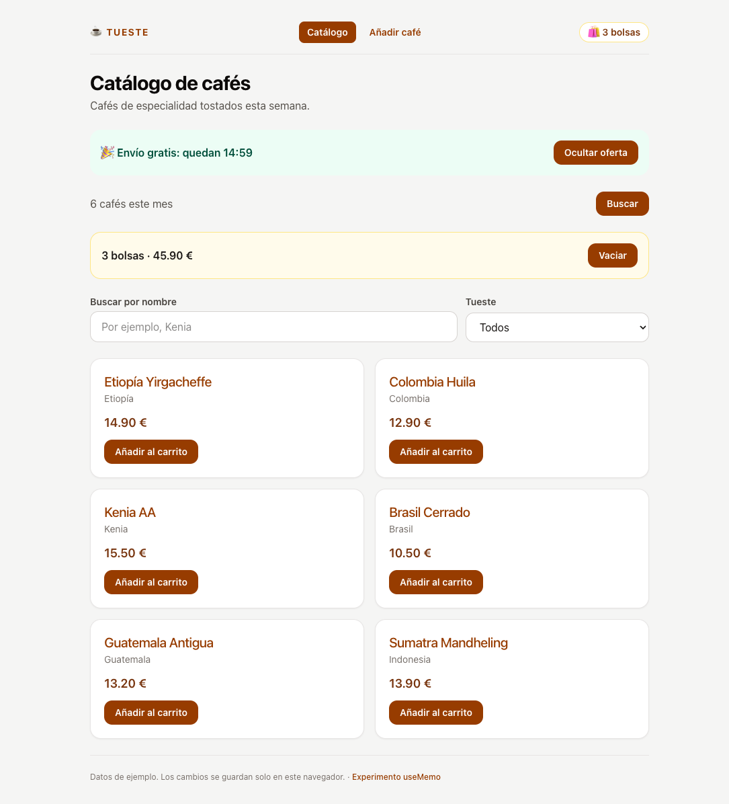
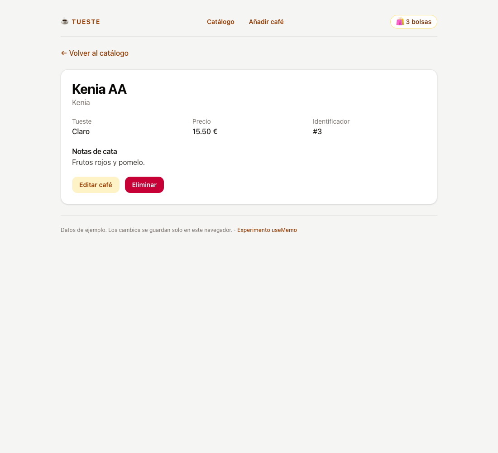
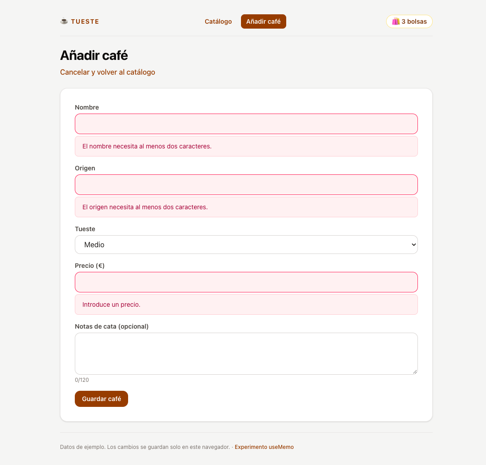
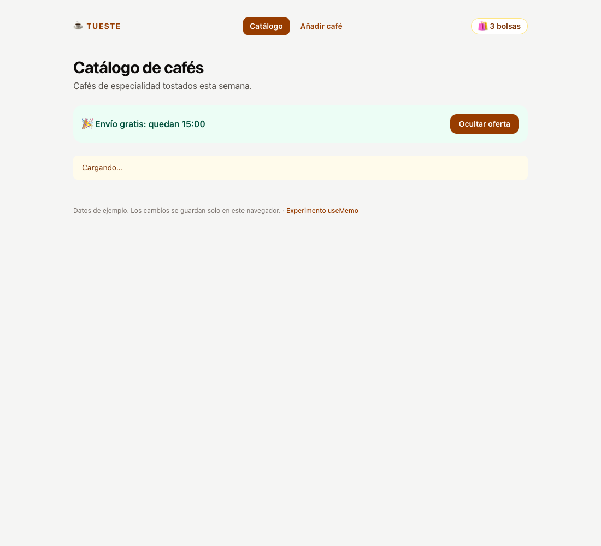
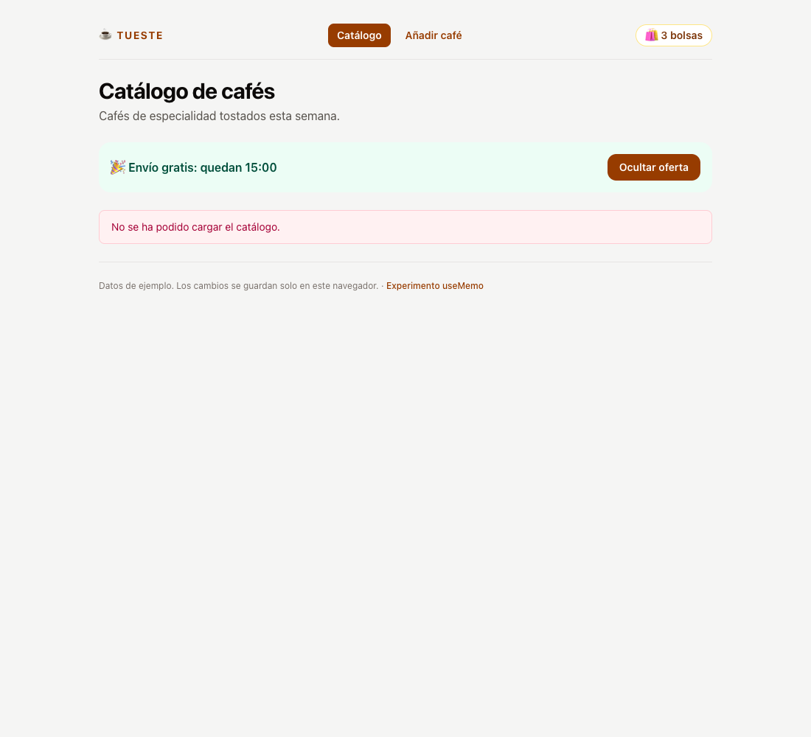

# ☕ Tueste · Laboratorio del módulo 4 (React)

El catálogo de Tueste hecho con React: una lista con buscador y carrito, el detalle de cada café, un formulario para dar de alta cafés y otro para editarlos, y al final todo organizado en escenas y pods. Parte de la demo `01-de-javascript-a-react/demos/02-react` del módulo. Cada obligatorio y cada opcional tiene su propio commit (`git log --oneline`).

Versiones: Node 22.17, Vite 8.3, TypeScript 7.0, React 19.3, Tailwind CSS 4.3, TanStack Router 1.170, TanStack Form 1.33, Zod 4.6.

## 🚀 Cómo arrancarlo

```bash
npm install
npm start
```

| Script              | Comando                      | Para qué sirve                                                                                                  |
| ------------------- | ---------------------------- | --------------------------------------------------------------------------------------------------------------- |
| `npm start`         | `vite`                       | Servidor de desarrollo en `http://localhost:5173`. El plugin del router regenera `routeTree.gen.ts` al guardar. |
| `npm run build`     | `vite build && tsc --noEmit` | Primero Vite (que genera el árbol de rutas) y después la comprobación de tipos, que necesita ese árbol.          |
| `npm run typecheck` | `tsc --noEmit`               | Sólo los tipos.                                                                                                 |
| `npm run preview`   | `vite preview`               | Sirve `dist/` para probar la versión de producción.                                                             |

> El `.npmrc` del repo apunta al registro público de npm: en mi máquina el registro global es uno corporativo que no da acceso a estos paquetes.

## 🗺️ Mapa de la aplicación

| Ruta                        | Qué muestra                                                                                                                     |
| --------------------------- | ------------------------------------------------------------------------------------------------------------------------------- |
| `/`                         | Redirige a `/coffees`.                                                                                                          |
| `/coffees`                  | El catálogo: oferta con cuenta atrás, número de cafés, carrito, buscador por nombre, filtro por tueste y la rejilla de tarjetas. |
| `/coffees?q=bra&roast=dark` | El mismo catálogo ya filtrado: el buscador y el tueste viven en la URL (P4).                                                    |
| `/coffees/:id`              | Detalle de un café: origen, tueste, precio, notas de cata, «Editar café» y «Eliminar». Si no existe, «Café no encontrado».      |
| `/coffees/new`              | Formulario de alta. Al guardar, navega al detalle del café nuevo.                                                               |
| `/coffees/:id/edit`         | El mismo formulario con los valores del café. Al guardar conserva el id y vuelve al detalle.                                     |
| `/experimentos/memo`        | El experimento de memorización con 2.000 cafés (P5). Enlazado desde el pie.                                                     |
| cualquier otra              | «Página no encontrada».                                                                                                         |

En todas las pantallas, la cabecera muestra la navegación y el número de bolsas del carrito.

## 📸 Capturas

| Catálogo con el carrito                                              | Detalle                                  |
| -------------------------------------------------------------------- | ---------------------------------------- |
|  |  |

| Formulario con errores                                           | Cargando…                               | Error                                                              |
| ---------------------------------------------------------------- | --------------------------------------- | ------------------------------------------------------------------ |
|  |  |  |

## ✅ Checklist

### Obligatorios

- [x] O1 · El catálogo con componentes
- [x] O2 · Un carrito con estado y eventos
- [x] O3 · Cargar los cafés con `useEffect`
- [x] O4 · Un custom hook y una ref
- [x] O5 · Lista y detalle con TanStack Router
- [x] O6 · Alta de cafés con TanStack Form y Zod
- [x] O7 · Edición y organización en pods
- [x] O8 · README + bitácora de IA

### Opcionales

- [x] P1 · Un carrito que no se pierde (Context)
- [x] P2 · Y que sobreviva también a recargar (localStorage)
- [x] P3 · Una cuenta atrás para la oferta
- [x] P4 · Filtros que viven en la URL
- [x] P5 · Memorizar… con cabeza
- [x] P6 · CSS Modules
- [x] P7 · Eliminar un café

### Desafíos

- [ ] D1 · Búsqueda con debounce
- [ ] D2 · React Compiler
- [ ] D3 · Un contrato de API distinto
- [ ] D4 · Tests de componentes
- [ ] D5 · Hacia TanStack Start

## 🗂️ Estructura final

```text
src/
  app.tsx                      RouterProvider
  main.tsx
  routes/                      sólo navegación: leen parámetros y pintan una escena
    __root.tsx                 AppLayout + "Página no encontrada"
    index.tsx                  "/" → "/coffees"
    coffees/
      index.tsx                validateSearch de ?q y ?roast
      new.tsx
      $coffeeId/
        index.tsx
        edit.tsx
    experimentos/memo.tsx
  core/
    router/router.ts           createRouter + Register
    coffees/                   lo que comparten los dos pods
      model.ts                 Coffee, CoffeeInput, Roast y las etiquetas del tueste
      coffee.schema.ts         reglas de Zod (alta y edición)
      api.ts                   getCoffees, getCoffee, saveCoffee, deleteCoffee
      hooks.ts                 useCoffees, useCoffee
    cart/                      Context del carrito (P1 y P2)
  layouts/app-layout.tsx       CartProvider + navegación + <Outlet />
  scenes/                      componen la pantalla y deciden adónde navegar
    catalogo.scene.tsx
    detalle.scene.tsx
    edicion.scene.tsx
  pods/
    catalogo/                  lista, buscador, carrito y detalle
      index.ts                 CatalogoContainer, DetalleContainer, CatalogoFilters
      catalogo.container.tsx / catalogo.component.tsx
      detalle.container.tsx / detalle.component.tsx
      components/coffee-card.tsx + coffee-card.module.css
    edicion/                   formulario de alta y edición
      index.ts                 AltaContainer, EdicionContainer
      edicion.container.tsx / edicion.component.tsx
  common/
    components/                request-status (Cargando / error) y offer-countdown
    format.ts                  precio con dos decimales y "1 bolsa / N bolsas"
  experiments/memo-lab.tsx     P5
```

`grep -rn "pods/edicion" src/pods/catalogo` no devuelve nada: el detalle enlaza con `<Link to="/coffees/$coffeeId/edit">`, sin importar el formulario.

## 📝 Respuestas

### O1 · Las `key`

Sin `key`, React escribe en la consola _Each child in a list should have a unique "key" prop. Check the render method of `App`_. La necesita para saber qué elemento de la lista es cuál entre un render y el siguiente: si se añade, se quita o se reordena un café, compara por `key` y sólo toca lo que ha cambiado, y cada tarjeta conserva su estado y su DOM. Uso `coffee.id` porque es estable y va con el café. El índice cambia en cuanto se filtra o se borra uno: la tarjeta que antes tenía la posición 2 pasa a ser otra, y React reutilizaría el DOM y el estado de la tarjeta equivocada.

### O2 · `onAdd={addToCart}` y el total

- `onAdd={addToCart}` pasa la función para que la tarjeta la llame al hacer clic. `onAdd={addToCart()}` la ejecutaría durante el render y pasaría su resultado (`undefined`). Además, como actualiza el estado, provocaría otro render, que la volvería a llamar, y así sin fin. Por eso en la tarjeta escribo `onClick={() => onAdd(coffee)}`: hace falta una función nueva para pasarle el café.
- El total se puede calcular a partir de `cart` con `reduce`, así que se calcula en cada render. Si fuera un estado, habría dos fuentes de la verdad que pueden no coincidir: habría que acordarse de actualizar el total en cada sitio que cambia el carrito (añadir, vaciar…). Y si se sincronizara con un `useEffect`, se pintaría primero el total antiguo y después un segundo render con el bueno.

### O3 · `useEffect` y `[]`

El cuerpo del componente se ejecuta en cada render. Un `fetch` ahí lanzaría una petición en cada render, y al llegar la respuesta el `setCoffees` provocaría otro render y otra petición: un bucle. Pedir datos es un efecto secundario (sincronizar el componente con algo de fuera), y para eso está `useEffect`, que se ejecuta después de pintar. El `[]` es la lista de dependencias: vacía significa «conéctate al montar y limpia al desmontar», sin repetir el efecto en cada render. La limpieza (`controller.abort()`) cancela la petición si el componente se desmonta antes de que llegue. Con `StrictMode` en desarrollo se ve un montaje, una limpieza y otro montaje: es una comprobación de React, no un error.

### O4 · Custom hook y ref

- Cada componente que llama a `useCoffees()` tiene **sus propios** estados y su propio efecto: un custom hook comparte la lógica, no los datos. Con dos componentes, dos peticiones a `/coffees.json` (y en desarrollo, por `StrictMode`, cada una se lanza, se cancela y se repite una vez).
- El foco no es un dato que se pinte: es una orden al DOM («enfoca este input»). Con estado habría un render que no cambia nada de la pantalla y seguiría haciendo falta el nodo para llamar a `focus()`. La ref guarda el nodo del input y cambiarla no provoca ningún render.

### O5 · Rutas

- Con una URL por pantalla, cada pantalla tiene una dirección: se puede compartir un enlace a `/coffees/3`, recargar sin perder la pantalla, y Atrás y Adelante funcionan. Con un booleano en el estado, el detalle sólo existe mientras dura ese estado. Además el `Link` está tipado: si escribo `coffeeID`, TypeScript se queja.
- El carrito vivía en un `useState` del componente del catálogo. Al ir al detalle, el router desmonta el catálogo, y al desmontar un componente se pierde su estado. Al volver se monta una instancia nueva con el carrito vacío. El estado tiene que vivir en un componente que no se desmonte al navegar, por encima de las rutas: el layout (es lo que hace P1).

### O6 · Zod y `valueAsNumber`

- La interfaz `Coffee` sólo existe al compilar: TypeScript la borra y no comprueba nada de lo que escribe el usuario en ejecución. Para TypeScript `"   "` es un `string` válido y `-3` un `number` válido. El esquema de Zod valida en ejecución (sin espacios, mínimo dos caracteres, precio mayor que 0, máximo 120 caracteres en las notas) y además transforma los datos: `saveCoffee` usa `coffeeSchema.parse`, así que el nombre se guarda sin los espacios de los lados.
- `event.target.value` siempre es un texto, aunque el input sea `type="number"`. Si el precio llegara como `"12.5"`, `z.number()` lo rechazaría siempre con un error de tipo, aunque el número sea correcto. Con `valueAsNumber` llega `12.5`. Si el campo está vacío llega `NaN`, que Zod también rechaza («Introduce un precio»). Por eso el valor vacío del formulario es `NaN`, y el input pinta `""` en ese caso para no pasarle `NaN` a `value`.

### O7 · Dónde cambiar cada cosa y container / component

| Cambio                            | Fichero                                                            |
| --------------------------------- | ------------------------------------------------------------------ |
| El diseño de la tarjeta de café   | `pods/catalogo/components/coffee-card.tsx` (y su `.module.css`)    |
| La regla de validación del precio | `core/coffees/coffee.schema.ts` (la usan alta y edición a la vez)  |
| Adónde se va después de guardar   | `scenes/edicion.scene.tsx` (la función `onSaved`)                  |

El container decide **qué** mostrar (pide los datos, distingue carga, error y «no encontrado», calcula lo derivado) y el component sólo decide **cómo** se ve a partir de sus props. Así puedo cambiar el aspecto sin tocar cómo se leen los datos, y el component es fácil de probar porque no hace peticiones. No lo haría en todos los componentes: la tarjeta, los mensajes de carga o la cuenta atrás son piezas pequeñas y separarlas sólo añadiría ficheros. Tiene sentido en la entrada de cada funcionalidad, donde de verdad se mezclan datos y presentación.

### P1 · Por qué Context

En el módulo, el estado se quedaba en el componente que lo usaba y se pasaba por props, porque cada dato lo necesitaba una sola pantalla. Context se presentó para un valor que necesitan varios descendientes a distintos niveles. El carrito ahora es justo eso: lo leen la cabecera del layout (el número de bolsas) y el catálogo (el resumen, añadir y vaciar), y entre el layout y el catálogo están el router, la escena y el container. Pasarlo por props obligaría a cruzar el `<Outlet />`, que no recibe props. El estado vive en `CartProvider`, dentro de `AppLayout`, que no se desmonta al navegar. `useCart()` lanza un error si no hay provider, para no ocultarlo con un valor por defecto vacío.

### P2 · Lectura en la inicialización, escritura en un efecto

`useState(readCart)` recibe la **función**, no su resultado: React sólo la ejecuta en el primer render, así que no se lee `localStorage` en cada render y el primer render ya tiene el carrito correcto (con un efecto se pintaría primero vacío y luego lleno). Escribir es sincronizar React con algo de fuera, y eso es un efecto: `useEffect(..., [cart])` guarda cada vez que cambia el carrito, después de pintar y sin repetirlo en renders donde el carrito no ha cambiado.

### P3 · La limpieza del intervalo

El efecto crea el intervalo al montar y devuelve `() => clearInterval(timer)`. Lo comprobé montando y desmontando el banner seis veces seguidas: en los tres segundos siguientes, la cuenta pasó de 15:00 a 14:57, un segundo por segundo. Sin la limpieza, cada montaje dejaría un intervalo vivo: al ocultar el banner seguirían llamando a `setSecondsLeft` sobre un componente desmontado y, al volver a mostrarlo, habría varios intervalos restando a la vez, así que la cuenta iría cada vez más rápido. El `setSecondsLeft(previous => …)` también es importante: con `secondsLeft - 1`, el callback se quedaría con el valor del primer render y la cuenta no pasaría de 14:59.

### P4 · Filtros en la URL

La ruta `/coffees/` declara `validateSearch` con un esquema de Zod: `q` es un texto opcional y `roast` reutiliza el `z.enum` del esquema del café. Con `.catch(undefined)`, un valor inválido como `?roast=azul` se descarta en lugar de romper la página. La ruta lee `Route.useSearch()` (ya tipado) y se lo pasa a la escena. La escena navega con `navigate({ search, replace: true })` para que cada tecla no añada una entrada al historial. El buscador ya no es un `useState`: su valor sale de la URL, así que `/coffees?roast=dark&q=bra` abre el catálogo filtrado.

### P5 · Lo que medí

En `/experimentos/memo` hay 2.000 cafés generados, un filtro y un botón «Cambio ajeno al listado» que sólo cambia un contador. Pulsé el botón cinco veces sin `useMemo` y cinco con `useMemo`:

| Versión       | `console.count` al montar | Por cada clic ajeno | Total tras 5 clics |
| ------------- | ------------------------- | ------------------- | ------------------ |
| Sin `useMemo` | 2 (StrictMode)            | 2                   | 12                 |
| Con `useMemo` | 2 (StrictMode)            | 0                   | 2                  |

`useMemo` hace lo que promete: el filtrado no se repite si `filter` no cambia. Pero medí también lo que cuesta filtrar 2.000 cafés: unos **0,07 ms**. Eso no se nota: no había ningún problema que arreglar. `useMemo` tiene su propio coste (guardar el resultado, comparar dependencias), hace el código más difícil de leer y, si se olvida una dependencia, el resultado es incorrecto. Además el componente sigue renderizando igual: sólo se ahorra el cálculo. Por eso no lo he puesto en el catálogo de verdad (6 cafés): sólo merece la pena cuando se ha medido un cálculo lento, o cuando la referencia estable la aprovecha alguien (un `memo` o la dependencia de un efecto).

### P6 · Tailwind frente a CSS Modules

La tarjeta usa `coffee-card.module.css`. En DevTools la clase aparece como `_card_43kqh_1`: Vite añade un prefijo y un hash para que `.card` sólo afecte a este componente. Con Tailwind, el aspecto se cambia en el propio JSX, en las clases de utilidad. Con CSS Modules se cambia en el `.module.css` que está al lado del componente, con CSS normal (`:hover`, transiciones…) y el JSX queda más limpio. En los dos casos el estilo viaja con el componente y basta un cambio para que cambien todas las tarjetas. El resto de la app sigue con Tailwind. Las reglas del módulo no van en una capa y las de la base sí, así que las del módulo ganan sin `!important`.

### P7 · Eliminar

- **Pod:** el botón y la confirmación están en el detalle, que es del pod `catalogo`. La confirmación se hace dentro de la página («¿Eliminar «Kenia AA» del catálogo? Sí, eliminar / Cancelar»), con el foco en «Cancelar», en lugar de un `window.confirm`.
- **Navegación:** el container borra y llama a `onDeleted`. La escena decide que, después de borrar, se vuelve a `/coffees`, igual que `onSaved` en la edición.
- **localStorage:** el JSON inicial no se puede modificar, así que `deleteCoffee` guarda los ids eliminados en otra clave (`tueste-lab4-deleted`) y `getCoffees` los quita al combinar. Si el café era uno creado en local, además se quita de los cambios. `saveCoffee` tiene en cuenta los ids eliminados al calcular el id nuevo: si no, un café creado después de borrar el último reutilizaría ese id y quedaría oculto.

## 🤖 Bitácora de IA

Herramienta: **Claude Code** (Claude Opus 5.5) en la terminal, con acceso al repositorio, a los apuntes del módulo y a Chrome (DevTools) para comprobar cada paso en el navegador.

### Cómo trabajé

Le di el enunciado completo del laboratorio y le pedí que leyera primero los apuntes del módulo 4 (las cuatro sesiones y sus demos) para aplicar los mismos patrones: el `api.ts` y los hooks con `AbortController` de la demo de rutas, el `member-form.tsx` de la demo de formulario y el mapa de pods de la demo de arquitectura. Le pedí los obligatorios y los opcionales, sin los desafíos, con un commit por apartado, y que comprobara cada 🔎 en el navegador antes de hacer el commit.

### El prompt principal

#### Prompt

> «Implementa el laboratorio del módulo 4 en este repositorio. Mira la teoría del cuarto módulo en `luckia-front-end-moderno-ia` para aplicarla al ejercicio. [enunciado completo] No hagas los desafíos (D1-D5).»

#### Qué me dio

La aplicación entera, commit a commit: de O1 (tarjetas a mano) a O7 (pods y escenas), y los siete opcionales. Comprobó cada paso en Chrome: quitó la `key` para ver el aviso en la consola, simuló una respuesta lenta y un error de `coffees.json`, rellenó el formulario con espacios y precio 0, editó un café y comprobó que no se duplicaba, y midió el experimento de `useMemo`.

#### Qué corregí y por qué

Nada: no tuve que cambiar nada de lo que me dio.

### Entender la sintaxis de los componentes de `app.tsx`

#### Prompt

> «Explícame la sintaxis de los componentes de `app.tsx`.» (Con el commit de O2 sacado, para repasarlo paso a paso.)

#### Qué me dio

Un recorrido línea a línea del fichero: `import type` (sólo tipos, desaparece al compilar), el array `coffees` fuera del componente para que no se cree en cada render, la firma de `CoffeeCard` (desestructurar las props y tiparlas en la misma línea, con `onAdd: (coffee: Coffee) => void` como tipo de función), las llaves `{ }` para meter expresiones en el JSX, `className` y `htmlFor` porque `class` y `for` son palabras reservadas, el genérico de `useState<Coffee[]>([])` (sin él, `[]` se infiere como `never[]`), el spread en `setCart(previous => [...previous, coffee])`, `reduce` y `filter` como datos derivados, el ternario para «Sin resultados» y el `map` con su `key`.

#### Qué corregí y por qué

En el código, nada: era una explicación. Me sirvió para separar lo que es sintaxis de JavaScript (desestructuración, spread, arrow functions, ternario) de lo que es de React (JSX, props, `useState`, `key`) y de lo que es de TypeScript (`import type`, el tipo de las props, el genérico). Lo que más me aclaró: `onAdd={addToCart}` pasa la función y `onClick={() => onAdd(coffee)}` crea una función nueva porque hay que pasarle el café de esa tarjeta.

### Pregunta sobre O5: ¿para qué sirve `key={id}` en el detalle?

#### Prompt

> «En la escena del detalle pones `<DetalleContainer key={id} id={id} />`. Si `useCoffee` ya tiene `[id]` en las dependencias del efecto y vuelve a pedir el café cuando cambia, ¿para qué hace falta la `key`?»

#### Qué me dio

Sin `key`, al pasar de `/coffees/3` a `/coffees/4` el router no desmonta nada: React reutiliza la misma instancia de `DetalleContainer` y sólo le cambia la prop `id`. El efecto se ejecuta **después** del render, así que el primer render con `id = "4"` todavía tiene en el estado el café 3 y `loading = false`: durante ese instante la URL dice 4 y la pantalla enseña el 3. Después el efecto limpia la petición anterior (`abort()`), pone `loading` a `true` y pide el 4. Con `key={id}`, al cambiar la `key` React desmonta la instancia vieja y monta una nueva, que empieza con su estado inicial (`loading = true`, sin café). Nunca se pinta el café equivocado. Es lo que explica la sesión 3: «al pasar de una persona a otra, esa clave cambia y React monta una nueva instancia».

#### Qué corregí y por qué

Nada en el código. Corregí la idea que tenía de la `key`: no es sólo para las listas del `map`. Sirve en cualquier componente para decirle a React «esto es otra cosa, empieza de cero». Por la misma razón, `EdicionScene` pone `key={id}` en `EdicionContainer`: si cambiara el café, el formulario no se quedaría con los valores del anterior.
